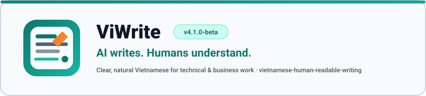
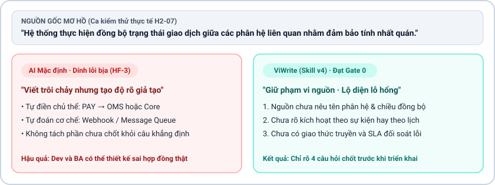
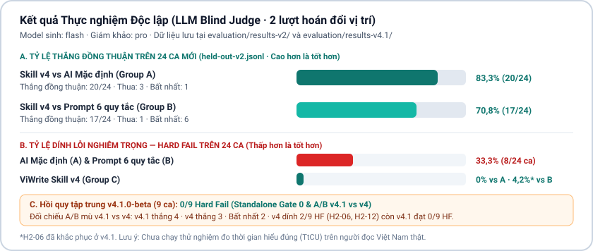

<p align="center">
  <picture>
    <source media="(prefers-color-scheme: dark)" srcset="assets/banner-en-dark.svg">
    
  </picture>
</p>

<p align="center">
  <strong>AI writes. Humans understand.</strong> — <em>AI viết. Con người hiểu.</em>
</p>

<p align="center">
  <a href="https://github.com/tronghongnguyen1012/vietnamese-human-readable-writing/releases/tag/v4.2.0-beta"></a>
  <a href="https://agentskills.io"></a>
  <a href="https://skills.sh"></a>
  
  <a href="./LICENSE"></a>
</p>

<p align="center">
  <a href="./README.md">Tiếng Việt</a> · <strong>English</strong> · <a href="./INSTALL.md">Installation Guide</a> · <a href="./examples/README.md">Real Examples</a> · <a href="./docs/compatibility-and-smoke-test.md">Compatibility &amp; Tests</a>
</p>

---

**ViWrite** (Agent Skill package [`vietnamese-human-readable-writing`](./skills/vietnamese-human-readable-writing/SKILL.md)) helps AI coding agents write Vietnamese that **domain readers understand on the first pass, trust at work, and can act on immediately**.

## The Problem ViWrite Solves

Readers already know the domain and understand every technical term on the page—yet they still have to re-read AI-generated Vietnamese multiple times to figure out what is actually being said.

Common failure modes in default AI Vietnamese:
- **English syntax underneath Vietnamese words:** Excessive nominalization (*"thực hiện việc kích hoạt sự mở rộng"*), mechanical passive voice, and 80–100-word run-on sentences.
- **Inverted reading order:** Opening with filler disclaimers while burying the decision, action item, or exception at the bottom.
- **Smooth wording hiding missing or unconfirmed specs:** When source notes omit numbers, actors, or edge cases, fluent prose can quietly present unverified guesses as settled rules.

**What improves with ViWrite installed:**
- Clear reading flow tailored to the real audience (Teams/Slack updates, developer architecture deep dives, customer-facing flows, PRD/BRs, and API/IDD specs).
- Full technical precision preserved (`>` vs `>=`, `and`/`or` logic, lock modes, API contracts, exceptions).
- Explicit separation between verified source facts and open questions whenever the prompt/input is incomplete.

### How ViWrite Differs from General Style / "Humanizer" Tools

Many writing polishers or "humanizers" focus primarily on natural rhythm, conversational phrasing, or passing style checks. In software and product work, however, **fluent tone alone does not guarantee accurate comprehension or safe execution**.

| Dimension | General Style / Humanizer Tools | ViWrite (`vietnamese-human-readable-writing`) |
|---|---|---|
| **Primary goal** | Natural tone and smoother sentence cadence. | First-pass comprehension and immediate usability for domain teams. |
| **Information structure** | Mostly sentence- or paragraph-level edits. | Context-driven layout: BLUF in workplace messages, clear decision branches and tables in specs. |
| **Technical fidelity** | Simplification can inadvertently blur thresholds, boolean operators, or edge cases. | Preserves exact rules, edge boundaries, and consistency across prose, tables, diagrams, and API specs. |
| **Incomplete sources** | Varies by tool; prioritizing fluency can leave gaps unmarked. | Keeps confirmed facts intact and separates unresolved parameters into explicit sign-off questions. |

---

## Before & After Examples

> **Clear labeling:** Below we separate **(1) verbatim benchmark outputs saved in `evaluation/`** from **(2) short illustrative phrasing notes**—we never present synthetic examples as benchmark data.

### 1. Rewriting Translationese While Keeping Exact Specs (Verbatim `TEST-23`)

Source: Case `TEST-23` ([held-out-test.jsonl](./evaluation/held-out-test.jsonl)) vs verbatim `Skill v4` output ([regression-v4-raw.jsonl](./evaluation/results-v2/regression-v4-raw.jsonl)):

- **Original translated input (108-word heavy sentence):**
  > *"Cơ chế tự động mở rộng theo chiều ngang (HPA) được cấu hình để kích hoạt việc tăng số lượng pod khi mức sử dụng CPU trung bình vượt qua ngưỡng 75% được duy trì trong một cửa sổ thời gian là 3 phút. Tuy nhiên, việc thu hẹp quy mô (scale-in) bị trì hoãn bởi một khoảng thời gian ổn định mặc định là 5 phút nhằm ngăn chặn sự dao động liên tục của các pod (flapping), và số lượng bản sao không bao giờ được giảm xuống dưới mức tối thiểu là 2 hoặc vượt quá mức tối đa là 12."*
- **ViWrite (`Skill v4`, verbatim — split into 3 active-voice sentences, 100% of specs retained: `75%`, `3 phút`, `5 phút`, `2`, `12`):**
  > *"HPA (cơ chế tự động mở rộng theo chiều ngang) được cấu hình để tăng số lượng pod khi mức sử dụng CPU trung bình vượt ngưỡng 75% và duy trì trong 3 phút. Tuy nhiên, HPA trì hoãn quá trình thu hẹp quy mô (scale-in) theo khoảng thời gian ổn định mặc định 5 phút nhằm ngăn tình trạng pod dao động liên tục (flapping). Ngoài ra, số lượng bản sao không bao giờ giảm xuống dưới mức tối thiểu 2 và không vượt quá mức tối đa 12."*

*(Non-benchmark phrasing illustration: instead of nominalized "Hệ thống tiến hành việc thực hiện gửi thông báo đến người dùng sau khi có sự hoàn tất của giao dịch", use direct actor-verb-object: "Hệ thống gửi thông báo cho người dùng sau khi giao dịch hoàn tất.")*

### 2. Preserving Scope on Underspecified Business Rules (Verbatim `H2-10`)

<p align="center">
  <picture>
    <source media="(prefers-color-scheme: dark)" srcset="assets/before-after-dark.svg">
    
  </picture>
</p>

See all 5 verbatim saved examples (natural chat, Teams message, ambiguous Business Rule, PostgreSQL RFC + Mermaid, and `H2-10`) in **[examples/](./examples/README.md)**.

---

## Installation

> **Recommended: [Skills CLI (`skills.sh`)](https://skills.sh)** — works uniformly across agents and is **smoke-tested on Windows**. Native plugin commands below are marked **`experimental`** (not yet live-tested because the native agent binaries are not installed on the test machine). Full steps, project-local updates (`-p`), global updates (`-g`), removal, and idempotent manual copy instructions are in **[INSTALL.md](./INSTALL.md)**.

### 1. Universal Skills CLI (`skills.sh`) — Recommended (Windows Verified)

```bash
# Interactive install (macOS / Linux / Windows)
npx skills add tronghongnguyen1012/vietnamese-human-readable-writing
```

On **Windows PowerShell** (use `npx.cmd` if ExecutionPolicy blocks `npx.ps1`, and `--copy` when symlink privileges are unavailable):

```powershell
# Project-local install
npx.cmd --yes skills add tronghongnguyen1012/vietnamese-human-readable-writing --copy -y

# Global install
npx.cmd --yes skills add tronghongnguyen1012/vietnamese-human-readable-writing -g --copy -y

# Update project-local (-p) or global (-g)
npx.cmd --yes skills update -p -y
npx.cmd --yes skills update -g -y
```

### 2. Claude Code & Claude Code Desktop

- **Recommended (Skills CLI):** `npx.cmd --yes skills add tronghongnguyen1012/vietnamese-human-readable-writing --skill vietnamese-human-readable-writing -a claude-code --copy -y`
- **Native Plugin (`experimental` — not live-verified):** Includes [`.claude-plugin/marketplace.json`](./.claude-plugin/marketplace.json) and [`.claude-plugin/plugin.json`](./.claude-plugin/plugin.json). Inside Claude Code:
  ```text
  /plugin marketplace add tronghongnguyen1012/vietnamese-human-readable-writing
  /plugin install vietnamese-human-readable-writing@vietnamese-human-readable-writing
  ```

### 3. OpenAI Codex (CLI, App & IDE Extension)

- **Recommended (Skills CLI):** `npx.cmd --yes skills add tronghongnguyen1012/vietnamese-human-readable-writing --skill vietnamese-human-readable-writing -a codex --copy -y`
- **Official Codex skill paths:** `.agents/skills/vietnamese-human-readable-writing/` (project-local) and `~/.agents/skills/vietnamese-human-readable-writing/` (global; legacy `$CODEX_HOME/skills/` / `~/.codex/skills/` also noted in `INSTALL.md`).
- **Native Plugin (`experimental` — not live-verified):** Includes [`.codex-plugin/plugin.json`](./.codex-plugin/plugin.json) and [`.agents/plugins/marketplace.json`](./.agents/plugins/marketplace.json) (`source: local, path: "./"`). Open the repo in Codex and browse via `/plugins`.

### 4. Antigravity (IDE, App & CLI)

- **Recommended (Skills CLI):** `npx.cmd --yes skills add tronghongnguyen1012/vietnamese-human-readable-writing --skill vietnamese-human-readable-writing -a antigravity --copy -y` (project: `.agents/skills/`, global: `~/.gemini/config/skills/`).
- **Native Plugin (`experimental` — `agy` CLI not present on test host):** [`.antigravity-plugin/plugin.json`](./.antigravity-plugin/plugin.json) validated against official JSON Schema `https://antigravity.google/schemas/v1/plugin.json`. CLI syntax: `agy plugin install https://github.com/tronghongnguyen1012/vietnamese-human-readable-writing`.

### 5. Cursor

- **Recommended (Skills CLI):** `npx.cmd --yes skills add tronghongnguyen1012/vietnamese-human-readable-writing --skill vietnamese-human-readable-writing -a cursor --copy -y` (project: `.agents/skills/`, global: `~/.cursor/skills/`).
- **Native Plugin (`experimental` — not live-verified):** Includes [`.cursor-plugin/plugin.json`](./.cursor-plugin/plugin.json) pointing `"skills": "./skills/"`.

---

## Honest 6-Level Compatibility Status

| Runtime | 1. Manifest / Schema | 2. Skills CLI Discovery | 3. File Install (`--copy`) | 4. Native Runtime Discovery | 5. Native Auto Activation | 6. Model Quality Evaluation |
|---|---|---|---|---|---|---|
| **Antigravity** | **Official Schema Valid** (`antigravity.google/schemas/v1/plugin.json`) | **Verified** | **Windows Verified** (project & sandbox `-g`) | **Workspace override verified** (`v4.2`, subagent host)\* | **Pos/Neg smoke verified** (`v4.2` & `v4.1`)\* | **Evaluated via Subagent** (`flash` / `pro` / `Gemini 4 Neon`)\* |
| **Claude Code / Desktop** | Marketplace SchemaStore Valid; plugin structural OK | **Verified** | **Windows Verified** (project & sandbox `-g`) | Not live-tested | Not live-tested | Untested on Claude models |
| **OpenAI Codex** | Structural Valid (`marketplace.json` `source: local`) | **Verified** | **Windows Verified** (project & sandbox `-g`) | Not live-tested | Not live-tested | Untested on GPT/Codex models |
| **Cursor** | Structural Valid (`.cursor-plugin/plugin.json`) | **Verified** | **Windows Verified** (project & sandbox `-g`) | Not live-tested | Not live-tested | Untested in Cursor Agent |

\* **Important distinction:** Antigravity `v4`/`v4.1` benchmarks used subagent injection, and the `v4.2.0-beta` smoke test & 7-case validation verified Antigravity workspace `.agents/skills/` override inside the IDE subagent harness (not the standalone `agy` CLI binary). ViWrite is not yet published on any vendor-curated marketplace. Full details and test logs are in **[docs/compatibility-and-smoke-test.md](./docs/compatibility-and-smoke-test.md)** and **[evaluation/v4.2-rc/native-validation-report.md](./evaluation/v4.2-rc/native-validation-report.md)**.

---

## When the Skill Applies

- **Use for:** Everyday Vietnamese conversation; technical explanations and architecture trade-offs; Slack/Teams/Email messages; PRD, BRD, User Story, Acceptance Criteria, Business Rules; IDD, SAD, API Spec, RFC, Runbook; editing machine-translated or overly bureaucratic Vietnamese text.
- **Not for:** Pure code generation, pure math solving, or non-Vietnamese-only tasks.

---

## Experimental Results & Deep Documentation

<p align="center">
  <picture>
    <source media="(prefers-color-scheme: dark)" srcset="assets/benchmark-chart-dark.svg">
    
  </picture>
</p>

- On **24 held-out cases** ([held-out-v2.jsonl](./evaluation/held-out-v2.jsonl), generator `flash`, two-pass position-swapped Blind Judge `pro`), `Skill v4` won **`20/24 (83.3%)`** vs a Neutral baseline (`0/24` vs `8/24` Hard Fails) and **`17/24 (70.8%)`** vs a 6-rule Simple Prompt (`1/24*` vs `8/24` Hard Fails).
- On the **9-case targeted regression** for **`v4.1.0-beta`**: **`0/9` Hard Fails** in both standalone Gate 0 audits and blind A/B checks vs `v4`.
- On the **focused native validation** for **`v4.2.0-beta`** ([native-validation-report.md](./evaluation/v4.2-rc/native-validation-report.md), `Gemini 4 Neon`): integrates selective refinements from two archived R&D rounds on top of `v4.1` (5 task modes to stop leaking internal open-question lists into end-user notices/emails, meaning-first reconstruction, flexible reading order, tighter `may` vs `will` / scope / domain-term preservation). Achieved **`7/7` Gate 0 PASS** (`0` Critical/Major, `1` Minor wording nuance on unseen `NV-06`) vs **`6/6` Gate 0 PASS** for native `v4.1` (`1` Minor with `2` missing must-preserve open questions on `NV-04`).

**Package layout & detailed research:**
- Runtime payload is self-contained inside [`skills/vietnamese-human-readable-writing/SKILL.md`](./skills/vietnamese-human-readable-writing/SKILL.md) (91 lines) and [`references/`](./skills/vietnamese-human-readable-writing/references/), loading `0–2` reference files depending on task complexity.
- [docs/compatibility-and-smoke-test.md](./docs/compatibility-and-smoke-test.md) — 6-level compatibility breakdown, Windows test logs, and MIT License + IP audit.
- [docs/DESIGN_DECISIONS.md](./docs/DESIGN_DECISIONS.md) · [docs/REVIEW-FINDINGS.md](./docs/REVIEW-FINDINGS.md) · [CHANGELOG.md](./CHANGELOG.md) — Architecture decisions & `v1 → v4.2.0-beta` release notes.
- [research/research-report.md](./research/research-report.md) · [evaluation/v4.1-stabilization-report.md](./evaluation/v4.1-stabilization-report.md) · [evaluation/evaluation-report-v2.md](./evaluation/evaluation-report-v2.md) · [evaluation/v4.2-rc/native-validation-report.md](./evaluation/v4.2-rc/native-validation-report.md) — Evaluation records (R&D branches preserved at tags [`archive/experiment-semantic-reconstruction`](https://github.com/tronghongnguyen1012/vietnamese-human-readable-writing/tree/archive/experiment-semantic-reconstruction) & [`archive/experiment-v5-communication-first`](https://github.com/tronghongnguyen1012/vietnamese-human-readable-writing/tree/archive/experiment-v5-communication-first)).

---

## Limitations & License

- **Current limitations:** `v4.2.0-beta` refinements are backed by a small `7`-case focused native validation and single-user directional Human Evaluation ([human-evaluation-log.md](./evaluation/v4.2-rc/human-evaluation-log.md)), **not statistical proof of overall superiority**. Because global `v4.1` remained installed in Antigravity, no pure 0-skill Gemini baseline was isolated in the native check ([prior-experiments-errata.md](./evaluation/v4.2-rc/prior-experiments-errata.md)). Earlier `v4` benchmarks used an LLM Blind Judge (`pro`) on `flash` outputs; multi-reader comprehension speed (*Time to Correct Understanding*, [human-eval-protocol.md](./evaluation/human-eval-protocol.md)) and live runs in Claude Code / Codex / Cursor remain untested.
- **License:** Released under the **[MIT License](./LICENSE)** (`Copyright (c) 2026 Trong Nguyen (tronghongnguyen1012)`). See the IP/reuse audit in [docs/compatibility-and-smoke-test.md](./docs/compatibility-and-smoke-test.md).
- **Bug reports:** Open an issue in [GitHub Issues](https://github.com/tronghongnguyen1012/vietnamese-human-readable-writing/issues) with the original prompt and output snippet.
