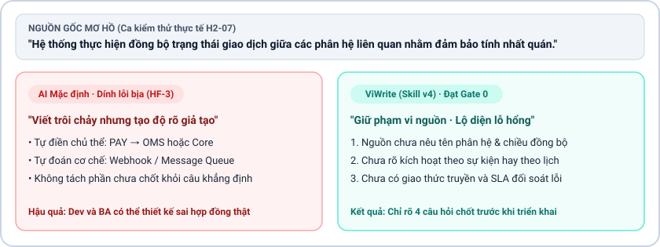

<p align="center">
  <picture>
    <source media="(prefers-color-scheme: dark)" srcset="assets/banner-dark.svg">
    
  </picture>
</p>

<p align="center">
  <a href="https://github.com/tronghongnguyen1012/vietnamese-human-readable-writing/releases/tag/v4.1.0-beta"></a>
  <a href="https://agentskills.io"></a>
  <a href="https://skills.sh"></a>
  
  <a href="./docs/compatibility-and-smoke-test.md#4-%C4%91%E1%BB%81-xu%E1%BA%A5t-gi%E1%BA%A5y-ph%C3%A9p-m%C3%A3-ngu%E1%BB%93n-m%E1%BB%9F-license-proposal"></a>
</p>

<p align="center">
  <strong>Tiếng Việt</strong> · <a href="./README.en.md">English</a> · <a href="./INSTALL.md">Cài đặt chi tiết</a> · <a href="./examples/README.md">Ví dụ thực tế</a>
</p>

---

**ViWrite** *(tên thương hiệu đề xuất cho gói skill `vietnamese-human-readable-writing`)* giúp AI IDE và Coding Agent viết tiếng Việt **rõ nghĩa ngay từ lần đọc đầu**, **đúng trình tự tiếp nhận**, **giữ trọn chiều sâu chuyên môn** và **tuyệt đối không tự bịa chi tiết khi nguồn thiếu dữ kiện**.

## Quick Start

Cài đặt bằng **1 câu lệnh** qua [Skills CLI (`skills.sh`)](https://skills.sh) (yêu cầu Node.js ≥ 22.20):

```bash
npx skills add tronghongnguyen1012/vietnamese-human-readable-writing
```

Trên **Windows PowerShell**, nếu hệ thống chặn `npx.ps1`, chạy thẳng `npx.cmd` kèm `--copy`:

```powershell
npx.cmd --yes skills add tronghongnguyen1012/vietnamese-human-readable-writing -g --copy
```

Xem hướng dẫn đầy đủ cho từng agent (`-a antigravity`, `claude-code`, `codex`, `cursor`), cập nhật, gỡ bỏ và cài thủ công không cần Node.js tại **[INSTALL.md](./INSTALL.md)**.

---

## Skill này giải quyết vấn đề gì?

AI có thể tạo văn bản tiếng Việt rất nhanh và đúng ngữ pháp, nhưng người đọc chuyên môn vẫn phải đọc đi đọc lại vì 3 vấn đề:
1. **Câu chữ mang cấu trúc tiếng Anh:** Lạm dụng danh từ hóa (*"cung cấp năng lực xử lý việc..."*), bị động máy móc (*"được... bởi..."*), rào đón dài dòng.
2. **Nhảy thẳng vào chi tiết hoặc nén mỏng kỹ thuật:** Để người đọc tự ghép điều kiện, ngoại lệ, hoặc rút gọn bảng so sánh làm sai cơ chế hệ thống.
3. **Tạo "độ rõ giả tạo" (*False Clarity*):** Khi yêu cầu gốc thiếu chủ thể, giao thức hay ngưỡng số, AI mặc định thường tự bịa tên hệ thống, API field hoặc quy tắc cho câu văn trôi chảy, khiến BA/Dev hiểu nhầm là dữ kiện đã chốt.

### Khác gì với "Humanizer" tiếng Việt thông thường?

| Tiêu chí | Humanizer thông thường | ViWrite (`vietnamese-human-readable-writing`) |
|---|---|---|
| **Mục tiêu cốt lõi** | Đổi giọng cho tự nhiên hoặc tránh bộ lọc AI. | Giúp **con người hiểu đúng ngay lần đọc đầu** và dùng được ngay vào công việc. |
| **Khi nguồn thiếu thông tin** | Dễ đoán bù để câu văn nghe mượt mà. | **Cấm tự bịa** — giữ phần chắc chắn và tách rõ điểm chưa chốt / câu hỏi mở. |
| **Tài liệu kỹ thuật & nghiệp vụ** | Ít quy tắc cho `và/hoặc`, biên `< / <=`, API contract hay sơ đồ. | Kiểm tra chéo văn bản–bảng–sơ đồ–BR–AC, giữ nguyên trạng thái `[Chưa chốt]` xuyên suốt. |
| **Hội thoại đời thường** | Thường áp dụng một giọng viết chung. | Tự động giữ nhẹ (`refs = []`), trả lời tự nhiên theo mạch trò chuyện. |

---

## Trước và Sau khi dùng Skill

<p align="center">
  
</p>

Xem thêm 5 ví dụ trích **nguyên văn** từ kết quả benchmark trong **[examples/](./examples/README.md)**:
- [Hội thoại tự nhiên](./examples/01-natural-conversation.md) (`H2-14`: 56 từ hài hước, `refs = []`, không giảng đạo lý)
- [Giao tiếp công việc trên Teams](./examples/02-workplace-communication.md) (`TEST-10`: đi thẳng BLUF, chia việc FE/BE sắc nét)
- [Business Rule đa nghĩa](./examples/03-business-rule-and-prd.md) (`H2-12`: bóc tách phương án có điều kiện, không chọn ngầm)
- [RFC Kỹ thuật & SAD có Mermaid](./examples/04-technical-and-sad.md) (`H2-06` kiểm chứng lock PostgreSQL, `H2-19` đồng bộ trạng thái `[Chưa chốt]`)
- [Nguồn thiếu dữ kiện (Trường hợp B)](./examples/05-ambiguous-source-case-b.md) (`H2-07`: chống *False Clarity*)

---

## Ngữ cảnh Hỗ trợ

- **Nên dùng (Kích hoạt tự động):** Hội thoại tiếng Việt hằng ngày; giải thích kiến thức & đánh đổi kỹ thuật chuyên sâu; tin nhắn Slack/Teams/Email công việc; PRD, BRD, User Story, Acceptance Criteria, Business Rule; IDD, SAD, API Spec, RFC, Runbook; biên tập lại văn bản tiếng Việt rối hoặc nặng dịch máy.
- **Không dùng:** Sinh code thuần túy, giải toán thuần túy, hoặc tác vụ hoàn toàn bằng ngôn ngữ khác tiếng Việt.

---

## Tương thích Agent & Runtime

> Báo cáo chi tiết cả 4 tầng (*Định dạng → Cài đặt → Nạp danh sách → Kích hoạt sinh*) và log smoke test Windows xem tại **[docs/compatibility-and-smoke-test.md](./docs/compatibility-and-smoke-test.md)**. Skill **chưa** phát hành trên curated marketplace chính thức của các hãng.

| Runtime | Định dạng & Manifest | Cài đặt trên Windows (`skills.sh`) | Nạp danh sách (`Discovery`) | Kích hoạt sinh (`Activation`) |
|---|---|---|---|---|
| **Antigravity IDE / CLI** | `SKILL.md` + `.antigravity-plugin/plugin.json` | Đã test thực tế (`--copy`, khớp SHA-256) | Đã xác minh (`skills list`) | **Đã kiểm chứng** (`flash` / `pro`) |
| **Claude Code & Desktop** | `SKILL.md` + `.claude-plugin/{plugin,marketplace}.json` | Đã test copy qua CLI (`-a claude-code`) | Chưa test live trong app Claude | Chưa kiểm chứng trên model Claude |
| **OpenAI Codex (CLI / App / IDE)** | `SKILL.md` + `.codex-plugin/` + `.agents/plugins/` | Đã test copy vào `.agents/skills/` | Chưa test live trong app Codex | Chưa kiểm chứng trên model GPT/Codex |
| **Cursor** | `SKILL.md` + `.cursor-plugin/plugin.json` | Đã test copy vào `.agents/skills/` | Chưa test live trong Cursor | Chưa kiểm chứng live trong Cursor |

---

## Cách Skill Hoạt động

1. **Phân loại ngữ cảnh & Nguồn (Context & Case Triage):** Tôn trọng trước mọi yêu cầu riêng của người dùng về văn phong/định dạng; tách **Trường hợp A** (nguồn đủ ý, diễn đạt rối) khỏi **Trường hợp B** (nguồn thiếu dữ kiện hoặc tự mâu thuẫn).
2. **Progressive Disclosure linh hoạt (`0 → 1 → tối đa 2` file):** Trò chuyện ngắn không đọc thêm file (`refs = []`); tác vụ chuyên sâu chỉ mở 1 file phù hợp trong [`skills/vietnamese-human-readable-writing/references/`](./skills/vietnamese-human-readable-writing/references/), hoặc tối đa 2 file với tài liệu lai (PRD kèm API, IDD kèm BR).
3. **Kiểm tra cuối có chọn lọc:** Với tài liệu chuyên môn phức tạp, đối chiếu lại 6 điểm (đủ ý, không mất điều kiện, giữ nguyên trạng thái `[Chưa chốt]` giữa văn bản–bảng–sơ đồ–BR–AC, kiểm chứng khẳng định kỹ thuật rủi ro cao) — **bỏ qua** bước kiểm tra nặng này trong hội thoại thường.

---

## Điểm nổi bật từ Thực nghiệm

<p align="center">
  
</p>

- **Chống bịa dữ kiện vượt xa prompt ngắn thông thường:** Trên 24 ca đa dạng của [held-out-v2.jsonl](./evaluation/held-out-v2.jsonl), `Skill v4` thắng **`20/24 (83,3%)`** trước AI mặc định (`0/24` vs `8/24` HF) và thắng **`17/24 (70,8%)`** trước Prompt 6 quy tắc (`1/24` vs `8/24` HF). Prompt ngắn thông thường vẫn dính tới `33,3%` lỗi Hard Fail khi gặp nguồn thiếu thông tin.
- **Bản vá ổn định `v4.1.0-beta`:** Trên 9 ca hồi quy tập trung đã biết (3 ca lỗi trọng tâm của v4 + hội thoại + kỹ thuật sâu + tài liệu dài), **v4.1 đạt `0/9` Hard Fail** ở cả kiểm định Gate 0 độc lập lẫn chấm mù `v4.1 vs v4`, khắc phục lỗi lock mode PostgreSQL (`H2-06`) và đồng bộ trạng thái `[Chưa chốt]` trên sơ đồ Mermaid (`H2-19`).

---

## Tài liệu Chuyên sâu (Nghiên cứu & Kiểm thử)

- [CHANGELOG.md](./CHANGELOG.md) — Lịch sử thay đổi `v1 → v4.1.0-beta`
- [docs/compatibility-and-smoke-test.md](./docs/compatibility-and-smoke-test.md) — Phân tích 4 repo tham chiếu, smoke test Windows & đề xuất License
- [docs/DESIGN_DECISIONS.md](./docs/DESIGN_DECISIONS.md) · [docs/REVIEW-FINDINGS.md](./docs/REVIEW-FINDINGS.md) — Quyết định kiến trúc & kết quả kiểm toán
- [research/research-report.md](./research/research-report.md) · [competitive-research-report.md](./research/competitive-research-report.md) — Cơ sở Việt ngữ học & đối chiếu 8 repo Skill
- [evaluation/v4.1-stabilization-report.md](./evaluation/v4.1-stabilization-report.md) · [evaluation-report-v2.md](./evaluation/evaluation-report-v2.md) — Báo cáo kiểm thử đầy đủ & đính chính đánh giá

---

## Giới hạn, Góp ý & Giấy phép

- **Giới hạn hiện tại:** Toàn bộ kết quả chất lượng văn bản hiện dựa trên **LLM Blind Judge (`pro`)** với model sinh **`flash`**; **chưa chạy thử nghiệm đo thời gian hiểu đúng (*Time to Correct Understanding*) trên người đọc Việt Nam thật** (quy trình đã thiết kế sẵn tại [human-eval-protocol.md](./evaluation/human-eval-protocol.md)). Các trường hợp tài liệu dài trong `held-out-v2.jsonl` là tài liệu mô phỏng, và prompt đầy đủ + file tham chiếu sẽ tăng độ trễ ở các tác vụ phức tạp.
- **Phản hồi & Đóng góp:** Khi báo lỗi đầu ra, vui lòng đính kèm prompt gốc, đoạn trả lời bị lỗi và mục [CONTRIBUTING / Issues](https://github.com/tronghongnguyen1012/vietnamese-human-readable-writing/issues). Không thay đổi tên định danh `vietnamese-human-readable-writing` hoặc dữ liệu lịch sử dưới `evaluation/results*`.
- **Giấy phép:** Hiện repository **chưa đính kèm tệp `LICENSE`**; xem phân tích đề xuất **MIT** / **Apache-2.0** tại [docs/compatibility-and-smoke-test.md](./docs/compatibility-and-smoke-test.md#4-%C4%91%E1%BB%81-xu%E1%BA%A5t-gi%E1%BA%A5y-ph%C3%A9p-m%C3%A3-ngu%E1%BB%93n-m%E1%BB%9F-license-proposal) trước khi chủ sở hữu phê duyệt.
