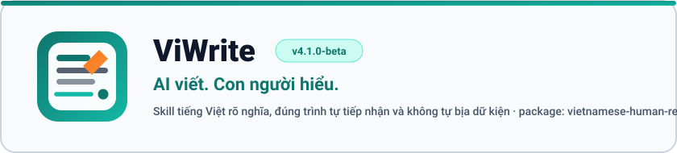
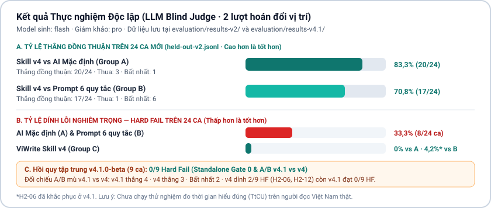

<p align="center">
  <picture>
    <source media="(prefers-color-scheme: dark)" srcset="assets/banner-dark.svg">
    
  </picture>
</p>

<p align="center">
  <strong>AI viết. Con người hiểu.</strong> — <em>AI writes. Humans understand.</em>
</p>

<p align="center">
  <a href="https://github.com/tronghongnguyen1012/vietnamese-human-readable-writing/releases/tag/v4.1.0-beta"></a>
  <a href="https://agentskills.io"></a>
  <a href="https://skills.sh"></a>
  
  <a href="./docs/compatibility-and-smoke-test.md"></a>
</p>

<p align="center">
  <strong>Tiếng Việt</strong> · <a href="./README.en.md">English</a> · <a href="./INSTALL.md">Cài đặt chi tiết</a> · <a href="./examples/README.md">Ví dụ benchmark thực tế</a> · <a href="./docs/compatibility-and-smoke-test.md">Tương thích &amp; Kiểm thử</a>
</p>

---

**ViWrite** (gói skill [`vietnamese-human-readable-writing`](./skills/vietnamese-human-readable-writing/SKILL.md)) giúp AI Agent viết tiếng Việt **dễ đọc, tự nhiên, đúng trình tự tiếp nhận và dùng được ngay trong công việc**.

## Vấn đề ViWrite giải quyết

Bạn hiểu rõ chuyên môn, nắm hết mọi thuật ngữ trong đoạn văn, **nhưng vẫn phải đọc đi đọc lại mới hiểu AI muốn nói gì.**

Đó là trải nghiệm phổ biến khi dùng AI viết tiếng Việt cho công việc hằng ngày:
- **Nặng cấu trúc tiếng Anh:** Lạm dụng danh từ hóa (*"thực hiện việc kích hoạt sự mở rộng"*), bị động máy móc (*"được trì hoãn bởi..."*), ghép hết điều kiện vào một câu dài 80–100 chữ.
- **Sắp xếp ngược trình tự tiếp nhận:** Bắt đầu bằng rào đón chung chung, giấu kết luận và việc cần làm xuống tận cuối tin nhắn hoặc tài liệu.
- **Độ mượt đánh đổi bằng sự mơ hồ hoặc đoán bù:** Khi yêu cầu gốc còn khuyết số liệu, đối tượng hay ngoại lệ, câu văn vẫn nghe trôi chảy nhưng ẩn đi điểm chưa chốt khiến kỹ sư, BA và vận hành dễ hiểu nhầm là quy tắc đã khóa.

**Giá trị khi cài ViWrite vào Agent của bạn:**
- Đọc hiểu đúng ngay từ lượt đọc đầu, tách ý rạch ròi theo đối tượng đọc (tin nhắn Teams/Slack, giải thích kỹ thuật cho Dev, tài liệu cho khách hàng, PRD/BR, API Spec/IDD).
- Giữ trọn chiều sâu kỹ thuật (biên `>` / `>=`, `và` / `hoặc`, API contract, ngoại lệ), không làm mỏng chuyên môn chỉ để câu ngắn đi.
- Gặp nguồn thiếu dữ kiện: giữ nguyên phần chắc chắn và tách riêng danh sách điểm cần chốt, **không tự điền** chi tiết ngoài tài liệu gốc.

### So sánh với công cụ trau chuốt văn phong ("Humanizer")

Một số công cụ Humanizer hoặc prompt biên tập thông thường tập trung vào việc làm câu chữ mượt mà hơn, đổi nhịp điệu tự nhiên hoặc phục vụ các kịch bản kiểm tra độ tự nhiên của văn bản. Tuy nhiên, trong môi trường kỹ thuật và sản phẩm, **trôi chảy chưa đồng nghĩa với đọc hiểu đúng để làm việc được ngay**.

| Khía cạnh | Công cụ trau chuốt câu chữ thông thường | ViWrite (`vietnamese-human-readable-writing`) |
|---|---|---|
| **Trọng tâm chính** | Tự nhiên hóa câu chữ, cải thiện giọng văn đọc xuôi tai. | Giúp người đọc chuyên môn **hiểu đúng ít tốn sức nhất** và ra quyết định / triển khai được ngay. |
| **Cấu trúc thông tin** | Thường sửa ở mức câu hoặc đoạn nối tiếp. | Tổ chức lại luồng đọc theo ngữ cảnh: BLUF ở tin nhắn/báo cáo, tách nhánh điều kiện/ngoại lệ trong spec. |
| **Bảo toàn ràng buộc chuyên môn** | Dễ vô tình gộp hoặc làm mờ biên số, toán tử logic, ngoại lệ khi rút gọn câu. | Giữ chặt điều kiện, ngoại lệ, đối chiếu nhất quán giữa văn bản – bảng – sơ đồ – API contract. |
| **Xử lý yêu cầu thiếu dữ kiện** | Tùy công cụ; khi tập trung viết cho mượt dễ bỏ qua bước khoanh vùng dữ kiện khuyết. | Tách rõ phần đã xác định từ nguồn khỏi danh sách điểm cần chốt trước khi viết đặc tả. |

---

## Trước và Sau khi dùng ViWrite

> **Phân biệt rõ:** Mục này tách riêng **(1) trích đoạn nguyên văn từ bộ benchmark đã lưu** và **(2) ví dụ minh họa nhanh cách gọt câu** — không gộp chung hoặc trình bày ví dụ minh họa như kết quả thực nghiệm.

### 1. Gọt câu nặng dịch máy giữ nguyên thông số (Trích nguyên văn `TEST-23`)

Nguồn: Ca `TEST-23` trong [held-out-test.jsonl](./evaluation/held-out-test.jsonl) — so sánh trực tiếp đầu vào dịch sát tiếng Anh với bản viết lại nguyên văn của `Skill v4` trong [regression-v4-raw.jsonl](./evaluation/results-v2/regression-v4-raw.jsonl):

- **Đầu vào gốc (câu ghép 108 từ nặng danh từ hóa):**
  > *"Cơ chế tự động mở rộng theo chiều ngang (HPA) được cấu hình để kích hoạt việc tăng số lượng pod khi mức sử dụng CPU trung bình vượt qua ngưỡng 75% được duy trì trong một cửa sổ thời gian là 3 phút. Tuy nhiên, việc thu hẹp quy mô (scale-in) bị trì hoãn bởi một khoảng thời gian ổn định mặc định là 5 phút nhằm ngăn chặn sự dao động liên tục của các pod (flapping), và số lượng bản sao không bao giờ được giảm xuống dưới mức tối thiểu là 2 hoặc vượt quá mức tối đa là 12."*
- **Đầu ra `ViWrite` (`Skill v4` nguyên văn — ngắt 3 câu chủ động, giữ 100% thông số `75%`, `3 phút`, `5 phút`, `2`, `12`):**
  > *"HPA (cơ chế tự động mở rộng theo chiều ngang) được cấu hình để tăng số lượng pod khi mức sử dụng CPU trung bình vượt ngưỡng 75% và duy trì trong 3 phút. Tuy nhiên, HPA trì hoãn quá trình thu hẹp quy mô (scale-in) theo khoảng thời gian ổn định mặc định 5 phút nhằm ngăn tình trạng pod dao động liên tục (flapping). Ngoài ra, số lượng bản sao không bao giờ giảm xuống dưới mức tối thiểu 2 và không vượt quá mức tối đa 12."*

*(Ví dụ minh họa ngắn ngoài benchmark: thay vì viết "Hệ thống tiến hành việc thực hiện gửi thông báo đến người dùng sau khi có sự hoàn tất của giao dịch", viết trực diện là "Hệ thống gửi thông báo cho người dùng sau khi giao dịch hoàn tất.")*

### 2. Giữ nguyên phạm vi nguồn khi đặc tả thiếu tham số (Trích nguyên văn `H2-10`)

<p align="center">
  <picture>
    <source media="(prefers-color-scheme: dark)" srcset="assets/before-after-dark.svg">
    
  </picture>
</p>

Xem đầy đủ nguyên văn 5 tình huống thực tế (hội thoại tự nhiên, Teams, Business Rule, RFC PostgreSQL + Mermaid, và ca `H2-10`) trong **[examples/](./examples/README.md)**.

---

## Cài đặt

> **Khuyến nghị dùng [Skills CLI (`skills.sh`)](https://skills.sh)** cho cả cài toàn cục và theo dự án vì hoạt động đồng nhất trên nhiều IDE/CLI và **đã được smoke test thực tế trên Windows**. Các phương thức cài dạng native plugin dưới đây đang ở trạng thái **`experimental`** (chưa kiểm chứng live do máy test không cài sẵn binary các runtime đó). Xem hướng dẫn đầy đủ, cập nhật (`-p` / `-g`), gỡ bỏ và copy thủ công tại **[INSTALL.md](./INSTALL.md)**.

### 1. Universal Skills CLI (`skills.sh`) — Khuyến nghị (Đã kiểm thử Windows)

```bash
# Cài nhanh (tương tác, hỗ trợ Linux/macOS/Windows)
npx skills add tronghongnguyen1012/vietnamese-human-readable-writing
```

Trên **Windows PowerShell** (dùng `npx.cmd` nếu PowerShell chặn `npx.ps1`, thêm `--copy` nếu chưa bật Developer Mode):

```powershell
# Cài cho dự án hiện tại
npx.cmd --yes skills add tronghongnguyen1012/vietnamese-human-readable-writing --copy -y

# Cài toàn cục (Global)
npx.cmd --yes skills add tronghongnguyen1012/vietnamese-human-readable-writing -g --copy -y

# Cập nhật riêng cho dự án hiện tại (-p) hoặc toàn cục (-g)
npx.cmd --yes skills update -p -y
npx.cmd --yes skills update -g -y
```

### 2. Claude Code & Claude Code Desktop

- **Khuyến nghị (Skills CLI):** `npx.cmd --yes skills add tronghongnguyen1012/vietnamese-human-readable-writing --skill vietnamese-human-readable-writing -a claude-code --copy -y`
- **Native Plugin (`experimental` — chưa kiểm chứng live):** Gồm [`.claude-plugin/marketplace.json`](./.claude-plugin/marketplace.json) và [`.claude-plugin/plugin.json`](./.claude-plugin/plugin.json). Trong Claude Code, chạy lần lượt 2 lệnh:
  ```text
  /plugin marketplace add tronghongnguyen1012/vietnamese-human-readable-writing
  /plugin install vietnamese-human-readable-writing@vietnamese-human-readable-writing
  ```

### 3. OpenAI Codex (CLI, App & IDE Extension)

- **Khuyến nghị (Skills CLI):** `npx.cmd --yes skills add tronghongnguyen1012/vietnamese-human-readable-writing --skill vietnamese-human-readable-writing -a codex --copy -y`
- **Đường dẫn Skill chính thức của Codex:** `.agents/skills/vietnamese-human-readable-writing/` (project-local) hoặc `~/.agents/skills/vietnamese-human-readable-writing/` (global). *(Thư mục `$CODEX_HOME/skills/` / `~/.codex/skills/` vẫn được giữ tương thích cho các thiết lập cũ).*
- **Native Plugin (`experimental` — chưa kiểm chứng live):** Gồm [`.codex-plugin/plugin.json`](./.codex-plugin/plugin.json) và [`.agents/plugins/marketplace.json`](./.agents/plugins/marketplace.json) (`source: local, path: "./"`). Mở repository trong Codex và chọn plugin qua lệnh `/plugins`.

### 4. Antigravity (IDE, App & CLI)

- **Khuyến nghị (Skills CLI):** `npx.cmd --yes skills add tronghongnguyen1012/vietnamese-human-readable-writing --skill vietnamese-human-readable-writing -a antigravity --copy -y` (project: `.agents/skills/`, global: `~/.gemini/config/skills/`).
- **Native Plugin (`experimental` — chưa kiểm chứng live vì máy test không có `agy` CLI):** Gồm [`.antigravity-plugin/plugin.json`](./.antigravity-plugin/plugin.json) đã kiểm tra khớp JSON Schema chính thức. Với Antigravity CLI: `agy plugin install https://github.com/tronghongnguyen1012/vietnamese-human-readable-writing`.

### 5. Cursor

- **Khuyến nghị (Skills CLI):** `npx.cmd --yes skills add tronghongnguyen1012/vietnamese-human-readable-writing --skill vietnamese-human-readable-writing -a cursor --copy -y` (project: `.agents/skills/`, global: `~/.cursor/skills/`).
- **Native Plugin (`experimental` — chưa kiểm chứng live):** Gồm [`.cursor-plugin/plugin.json`](./.cursor-plugin/plugin.json) trỏ `"skills": "./skills/"` để nạp từ repo.

---

## Mức độ Tương thích & Kiểm chứng (6 Tầng Độc lập)

ViWrite phân tách trung thực **6 tầng kiểm chứng** thay vì gộp chung kết quả cài file hay benchmark model thành "hỗ trợ đầy đủ":

| Runtime | 1. Manifest / Schema | 2. Skills CLI Discovery | 3. Cài đặt File (`--copy`) | 4. Native Runtime Discovery | 5. Native Auto Activation | 6. Đánh giá Chất lượng Model |
|---|---|---|---|---|---|---|
| **Antigravity** | **Đạt Schema chính thức** (`antigravity.google/schemas/v1/plugin.json`) | **Đã xác minh** | **Đã kiểm thử Windows** (project-local & sandbox `-g`) | Chưa test live app/CLI `agy` | Chưa test live app/CLI `agy` | **Đã đánh giá qua Subagent** (`flash` / `pro`)\* |
| **Claude Code / Desktop** | `marketplace.json` đạt SchemaStore; `plugin.json` hợp lệ cấu trúc | **Đã xác minh** | **Đã kiểm thử Windows** (project-local & sandbox `-g`) | Chưa kiểm chứng live | Chưa kiểm chứng live | Chưa đánh giá trên model Claude |
| **OpenAI Codex** | Hợp lệ cấu trúc (`marketplace.json` `source: local`) | **Đã xác minh** | **Đã kiểm thử Windows** (project-local & sandbox `-g`) | Chưa kiểm chứng live | Chưa kiểm chứng live | Chưa đánh giá trên model GPT/Codex |
| **Cursor** | Hợp lệ cấu trúc (`.cursor-plugin/plugin.json`) | **Đã xác minh** | **Đã kiểm thử Windows** (project-local & sandbox `-g`) | Chưa kiểm chứng live | Chưa kiểm chứng live | Chưa đánh giá trên Cursor Agent |

\* **Lưu ý minh bạch:** Toàn bộ kết quả đánh giá trên Antigravity (v4 & v4.1) được chạy thông qua **Antigravity subagent** (tầng 6), **không** dùng làm bằng chứng cho khả năng *Native Runtime Discovery* (tầng 4) hay *Native Automatic Activation* (tầng 5) trong IDE/CLI thật. Skill cũng chưa được phát hành lên curated marketplace chính thức của các hãng. Chi tiết đầy đủ và nhật ký kiểm thử xem tại **[docs/compatibility-and-smoke-test.md](./docs/compatibility-and-smoke-test.md)**.

---

## Khi nào Skill được kích hoạt?

- **Nên dùng:** Hội thoại tiếng Việt tự nhiên; giải thích kiến thức & trade-off kỹ thuật; tin nhắn Slack/Teams/Email công việc; PRD, BRD, User Story, Acceptance Criteria, Business Rule; IDD, SAD, API Spec, RFC, Runbook; biên tập văn bản tiếng Việt dịch máy hoặc dài dòng.
- **Không dùng:** Sinh code thuần túy, giải toán thuần túy, hoặc tác vụ chỉ bằng ngôn ngữ khác tiếng Việt.

---

## Kết quả Thực nghiệm & Tài liệu Nghiên cứu

<p align="center">
  <picture>
    <source media="(prefers-color-scheme: dark)" srcset="assets/benchmark-chart-dark.svg">
    
  </picture>
</p>

- Trên **24 ca kiểm thử mới** ([held-out-v2.jsonl](./evaluation/held-out-v2.jsonl), model sinh `flash`, LLM Blind Judge `pro` chấm mù 2 lượt hoán đổi): `Skill v4` thắng đồng thuận **`20/24 (83,3%)`** trước AI mặc định (`0/24` vs `8/24` Hard Fail) và thắng **`17/24 (70,8%)`** trước Prompt 6 quy tắc (`1/24*` vs `8/24` Hard Fail).
- Trên **9 ca hồi quy tập trung** của bản phát hành **`v4.1.0-beta`**: đạt **`0/9` Hard Fail** ở cả kiểm định độc lập lẫn đối chiếu mù với `v4`.

**Cơ chế gói Skill & tài liệu chuyên sâu:**
- Gói thực thi nằm gọn trong [`skills/vietnamese-human-readable-writing/SKILL.md`](./skills/vietnamese-human-readable-writing/SKILL.md) (82 dòng) và [`references/`](./skills/vietnamese-human-readable-writing/references/) (`business-specs`, `information-architecture`, `technical-specs`, `vietnamese-clarity-and-style`), giữ nhẹ hội thoại thường và chỉ nạp đúng tài liệu cần thiết cho đặc tả phức tạp.
- [docs/compatibility-and-smoke-test.md](./docs/compatibility-and-smoke-test.md) — Ma trận tương thích 6 tầng, nhật ký smoke test Windows & kiểm toán quyền sử dụng mã nguồn mở (đề xuất **MIT License**).
- [docs/DESIGN_DECISIONS.md](./docs/DESIGN_DECISIONS.md) · [docs/REVIEW-FINDINGS.md](./docs/REVIEW-FINDINGS.md) · [CHANGELOG.md](./CHANGELOG.md) — Thiết kế kiến trúc & lịch sử phát hành `v1 → v4.1.0-beta`.
- [research/research-report.md](./research/research-report.md) · [evaluation/v4.1-stabilization-report.md](./evaluation/v4.1-stabilization-report.md) · [evaluation/evaluation-report-v2.md](./evaluation/evaluation-report-v2.md) — Cơ sở Việt ngữ học & báo cáo kiểm thử chi tiết.

---

## Giới hạn & Giấy phép

- **Giới hạn hiện tại:** Đánh giá chất lượng văn bản đến nay mới dùng **LLM Blind Judge (`pro`)** với model sinh **`flash`**; **chưa chạy thử nghiệm đo thời gian hiểu đúng (*Time to Correct Understanding*) trên người đọc Việt Nam thật** (quy trình đã chuẩn bị sẵn tại [evaluation/human-eval-protocol.md](./evaluation/human-eval-protocol.md)). Các ca tài liệu dài trong `held-out-v2.jsonl` là dữ liệu mô phỏng.
- **Giấy phép:** Repository **chưa đính kèm tệp `LICENSE`**. Sau khi kiểm toán toàn bộ tài sản nội bộ hoàn toàn tự biên soạn (xem [docs/compatibility-and-smoke-test.md](./docs/compatibility-and-smoke-test.md)), dự án đề xuất áp dụng **MIT License** và sẽ chỉ tạo tệp `LICENSE` khi chủ repository xác nhận.
- **Góp ý lỗi đầu ra:** Vui lòng mở Issue tại [GitHub Issues](https://github.com/tronghongnguyen1012/vietnamese-human-readable-writing/issues) kèm prompt gốc và đoạn trả lời gặp vấn đề.
