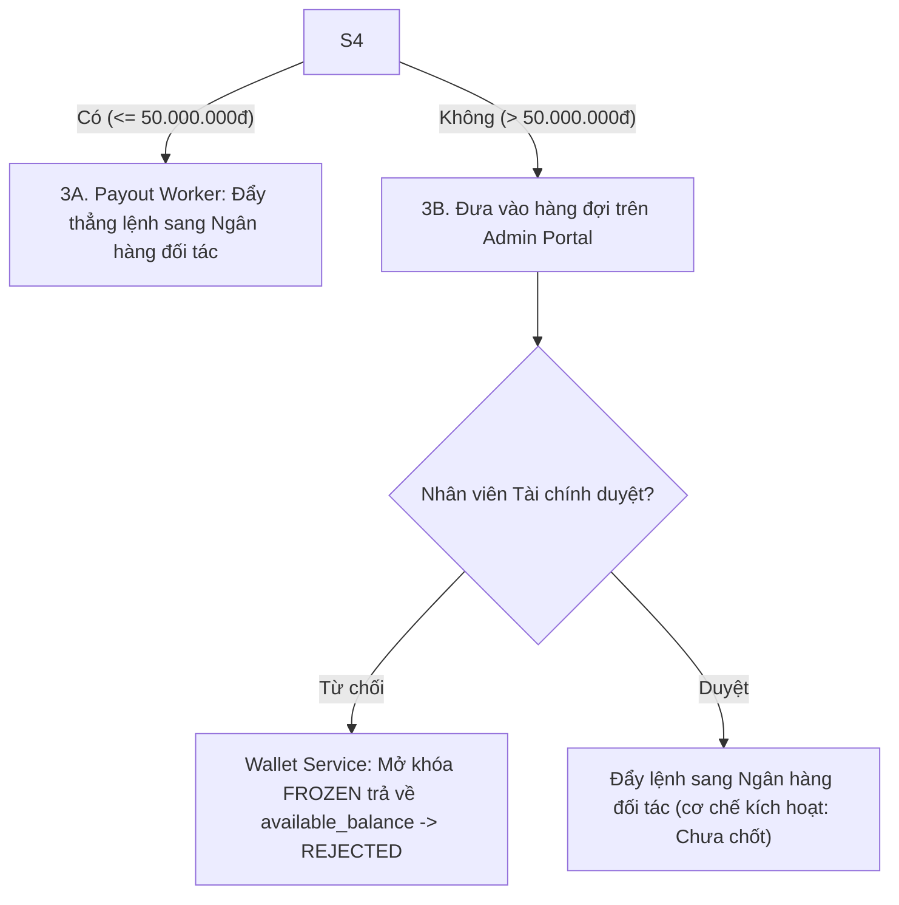

# Ví dụ 4: Tài liệu Kỹ thuật RFC & Kiến trúc SAD (`H2-06`, `H2-19`)

- **Nguồn dữ liệu:** Ca `H2-06` và `H2-19` ([held-out-v2.jsonl](../evaluation/held-out-v2.jsonl)), đối chiếu giữa bản `v4` ([held-out-v2-gen-C.jsonl](../evaluation/results-v2/held-out-v2-gen-C.jsonl)) và bản vá `v4.1` ([targeted-regression-v41-gen.jsonl](../evaluation/results-v4.1/targeted-regression-v41-gen.jsonl)).
- **Mục tiêu kiểm chứng:** Kiểm chứng khẳng định kỹ thuật ảnh hưởng tới an toàn dữ liệu/vận hành (`H2-06`) và giữ nguyên trạng thái `[Chưa chốt]` đồng bộ trên bảng, sơ đồ Mermaid và mục câu hỏi mở (`H2-19`).

---

## Phần A: Kiểm chứng Lock Mode trên PostgreSQL 15 (`H2-06`)

### Điểm lỗi từng xảy ra ở bản `v4` (bị Standalone Judge bắt `HF-2` cả `2/2` lượt)
Ở ghi chú phụ Mục 5, bản `v4` từng viết: *"thêm `CHECK (tax_code <> 'NONE') NOT VALID` (giữ `SHARE ROW EXCLUSIVE` ngắn, kèm `lock_timeout`) sau Pha 3"* — nhầm lock mode của `ADD CHECK NOT VALID` sang khóa của `ADD FOREIGN KEY`. Ở tải `3.000 QPS`, nhầm sang `SHARE ROW EXCLUSIVE` khiến người vận hành đánh giá sai nguy cơ chặn luồng `SELECT`.

### Cách `Skill v4.1` sửa trong thực tế (`0 HF`, `0 Major`, thắng `2–0` trước `v4`)
> - `ALTER TABLE ... ADD COLUMN` và `ALTER TABLE ... DROP DEFAULT` đều yêu cầu **`ACCESS EXCLUSIVE`** lock, xung đột với mọi lock khác (kể cả `ACCESS SHARE` của `SELECT`). `[...]`
> - **Ràng buộc chuỗi rỗng `''`:** `NOT NULL` không chặn chuỗi rỗng (`''`). Cần chốt với đội nghiệp vụ xem DB có cần chặn `''` hay không; nếu cần, bổ sung ở Pha 3 bằng `CHECK (tax_code <> '') NOT VALID` rồi chạy `VALIDATE CONSTRAINT` (dùng `SHARE UPDATE EXCLUSIVE`, không chặn đọc/ghi).

*(Xem trọn vẹn RFC 3 pha ROLLOUT/ROLLBACK trong [targeted-regression-v41-gen.jsonl](../evaluation/results-v4.1/targeted-regression-v41-gen.jsonl).)*

---

## Phần B: Đồng bộ Trạng thái Xác nhận trên Sơ đồ & Văn bản (`H2-19`)

- **Vấn đề ở bản `v4`:** Bảng thành phần và sơ đồ Mermaid vẽ thẳng nhánh sau duyệt tài chính (`> 50.000.000đ`) vào `Payout Worker`, nhưng tới Mục 4.2 & Mục 6 lại ghi việc đẩy qua `Payout Worker` hay gọi trực tiếp là **"chưa chốt"**.
- **Cách `Skill v4.1` xử lý trên sơ đồ Mermaid & trình tự tương tác (`0 HF`, thắng `2–0` trước `v4`):**

- Đồng bộ ngay tại trình tự tương tác (`L100`): *"Nếu Nhân viên Tài chính **duyệt**, yêu cầu được chuyển tiếp sang bước đẩy lệnh cho `Ngân hàng đối tác` `[Thành phần kích hoạt & giao thức sau duyệt: Chưa chốt]`."* — khớp 100% với mục `Điểm Cần Chốt Trước Khi Thiết kế Chi tiết & Triển khai`. *(Ghi chú trung thực: trong bản v4.1 vẫn còn một góp ý nhẹ ở ô bảng Mục 2 ghi kèm `xem ghi chú`.)*
